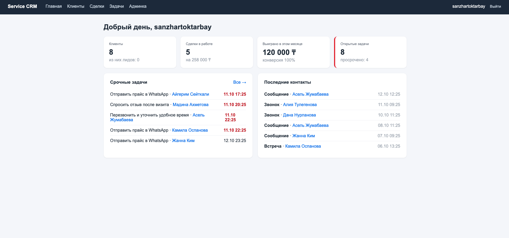
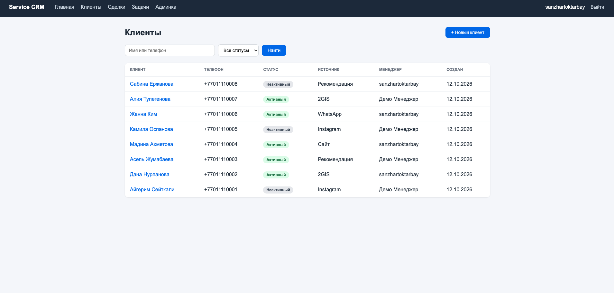
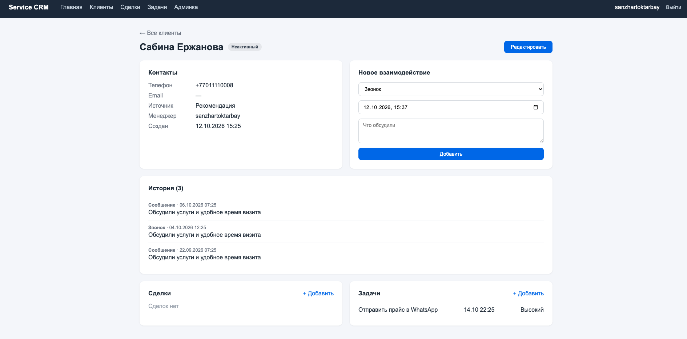
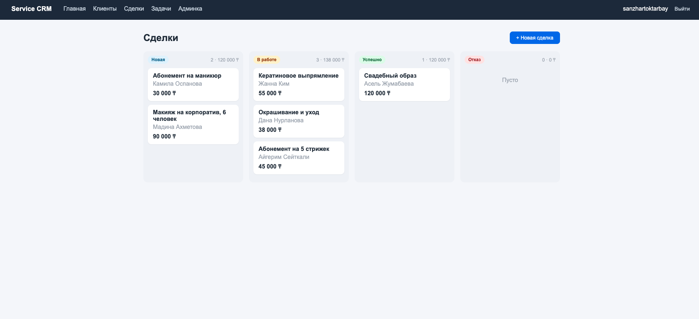
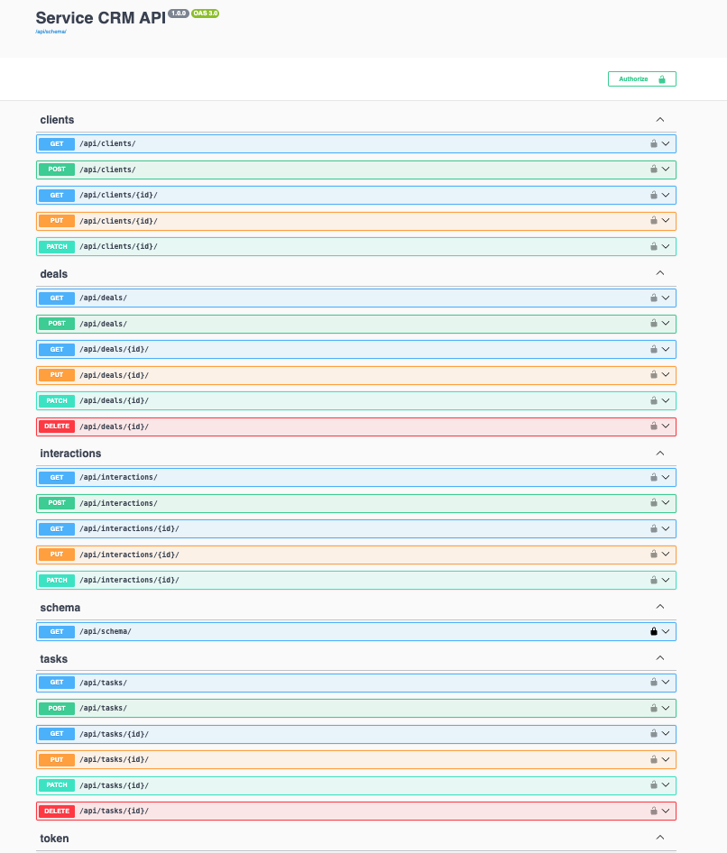

# Service CRM

[](https://github.com/SanzharToktarbay/service-crm/actions/workflows/tests.yml)

A CRM for small service businesses (beauty salons, barbershops, studios, clinics): clients and their contact history, a deals pipeline, tasks for managers, a dashboard with key metrics, role-based access and a REST API.

**Live demo:** https://service-crm-g98h.onrender.com
**Demo login:** `demo` / `demo12345` (manager role: sees only their own clients)
**API docs:** https://service-crm-g98h.onrender.com/api/docs/

> Hosted on a free tier: the first request after a period of inactivity may take up to a minute while the server wakes up.



## Features

- **Clients** with search, status filters and a full card: contacts, interaction history, deals and tasks in one place.
- **Phone normalization**: `8 707 123 45 67`, `+7 (707) 123-45-67` and `7071234567` are stored as `+77071234567`, so the same client can't be added twice in a different format.
- **Deals pipeline** as a board: New → In progress → Won / Lost, with totals per stage in ₸. A lost deal requires a reason, and the close date is set automatically.
- **Tasks** with priorities, due dates and overdue highlighting; one-click completion.
- **Dashboard**: clients, open deals, revenue won this month, conversion rate, urgent tasks and recent contacts.
- **Roles**: staff see everything, managers see only their own clients, deals and tasks, in the UI and in the API.
- **REST API** with token authentication, pagination, search and auto-generated Swagger documentation.

## Screenshots

| Clients | Client card |
|---|---|
|  |  |

| Deals board | API docs |
|---|---|
|  |  |

## Tech stack

- **Backend:** Python 3.14, Django 5.2, Django REST Framework, drf-spectacular
- **Database:** PostgreSQL 17 (SQLite for quick local development)
- **Frontend:** Django templates, hand-written HTML and CSS
- **Infrastructure:** Docker, Docker Compose, Gunicorn, WhiteNoise
- **CI:** GitHub Actions running the test suite against PostgreSQL on every push
- **Hosting:** Render (app) and Neon (database)

## Design decisions

- **Access control lives in the queryset, not the template.** A single `scope_for_user` function filters data by role and is reused by list and detail views, forms and API viewsets. A manager opening another manager's client gets a 404, not a hidden row.
- **Forms and serializers only offer what the user may access.** Related-object dropdowns are limited to the user's own records, so a forged ID in a request is rejected by validation.
- **Deliberate `on_delete` choices.** Interaction history is `PROTECT`ed, tasks are `CASCADE`d with their client, a task survives its deal being deleted (`SET_NULL`), and users with tasks can't be deleted (deactivate them instead). Clients and history can't be deleted through the API at all.
- **Validation in both forms and serializers.** DRF doesn't call `Model.clean()`, so business rules (phone normalization, no future interactions, lost deals need a reason) are enforced in the serializers too, including for partial `PATCH` updates.
- **Metrics in one query.** Dashboard numbers use conditional aggregation (`Count`/`Sum` with `filter=`), and the month boundary is calculated in local time (Asia/Almaty).
- **Security basics:** secrets in environment variables, `DEBUG` off by default, POST + CSRF for every state change, protection against open redirects, secure cookies behind HTTPS, non-root user in the Docker image.

## Running locally

```bash
git clone https://github.com/SanzharToktarbay/service-crm.git
cd service-crm
python3 -m venv .venv
source .venv/bin/activate
pip install -r requirements-dev.txt
cp .env.example .env              # then put a real SECRET_KEY into .env
python manage.py migrate
python manage.py createsuperuser
python manage.py seed_demo --password demo12345   # optional demo data
python manage.py runserver
```

Open http://127.0.0.1:8000.

### With Docker and PostgreSQL

```bash
docker compose up --build
docker compose exec web python manage.py createsuperuser
```

Open http://localhost:8000.

## Tests

```bash
python manage.py test
coverage run manage.py test && coverage report
```

The tests focus on business rules and access control: role-based visibility in the UI and API, 404 for other managers' records, ignoring a forged `manager` field, phone normalization and duplicates, deal and task lifecycle, and open-redirect protection.

## API

Get a token and call the API:

```bash
curl -X POST https://service-crm-g98h.onrender.com/api/token/ \
  -d "username=demo&password=demo12345"

curl https://service-crm-g98h.onrender.com/api/clients/ \
  -H "Authorization: Token <your-token>"
```

| Endpoint | Methods |
|---|---|
| `/api/clients/` | GET, POST, PUT, PATCH (no DELETE) |
| `/api/interactions/` | GET, POST, PUT, PATCH (no DELETE) |
| `/api/deals/` | GET, POST, PUT, PATCH, DELETE |
| `/api/tasks/` | GET, POST, PUT, PATCH, DELETE |

Filtering and search: `?search=`, `?status=`, `?stage=`, `?client=`, `?is_done=true`, `?ordering=-created_at`.

## Project structure

```
clients/     clients, interaction history, role scoping, demo data command
deals/       deals pipeline
tasks/       manager tasks
config/      settings, URLs, dashboard
templates/   HTML templates
static/      CSS
```

## Possible improvements

- A service layer for business rules shared by forms and the API
- Background reminders for upcoming tasks (Celery + Redis)
- Integration with an online booking service through the REST API
